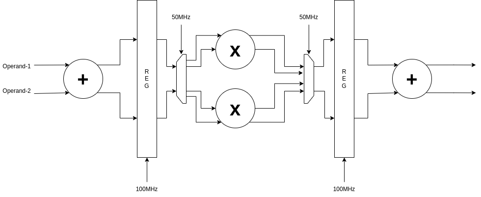
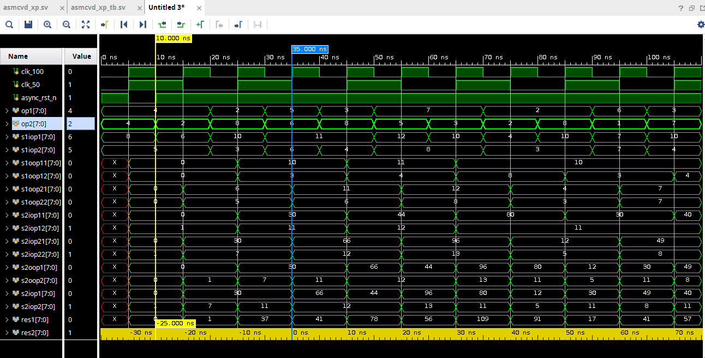

# bi-tribble

An experimental SystemVerilog datapath that explores using parallel arithmetic units and alternating clock phases to give slower logic more time while accepting inputs at a faster rate.

The datapath follows **ADD → MULTIPLY → ADD**, using 100 MHz and 50 MHz clocks in the supplied testbench.

## How it works

- The testbench updates an operand pair every 10 ns and generates a 100 MHz clock.
- Two first-stage register banks sample on opposite phases of the 50 MHz clock, feeding separate combinational multipliers.
- Each bank receives new operands every 20 ns.
- Selection logic alternates between the multiplier paths, followed by a register stage on the 100 MHz clock and the final adder.

Inputs, intermediate datapath signals, and outputs are 8 bits wide. Arithmetic results therefore retain only the bits that fit in those signals.

The original experiment targeted a best-case latency of 30 ns. Treat this as the design intent, rather than a guaranteed timing result for an FPGA implementation.

## Source guide

| File | Role |
| --- | --- |
| [rtl/asmcvd_xp.sv](rtl/asmcvd_xp.sv) | Top-level datapath and multiplier-path selection |
| [rtl/adder.sv](rtl/adder.sv) | Outputs `operand_1 + operand_2` and `operand_1 + 1` |
| [rtl/multiplier.sv](rtl/multiplier.sv) | Outputs `operand_1 * operand_2` and `operand_1 + 1` |
| [rtl/pipeline_reg.sv](rtl/pipeline_reg.sv) | Register pair with active-low asynchronous reset |
| [tb/asmcvd_xp_tb.sv](tb/asmcvd_xp_tb.sv) | Clock generation, reset stimulus, and random operands |
| [schematic/schematic.pdf](schematic/schematic.pdf) | Exported design schematic |
| [docs](docs/) | Concept image and editable draw.io diagrams |
| [waveform](waveform/) | Recorded simulation screenshots |

## Simulate in Vivado / XSIM

The original results were produced with Vivado Design Suite and XSIM; no Vivado project file is included.

1. Create an RTL project and add all four `rtl/*.sv` files as SystemVerilog design sources.
2. Set `asmcvd_xp` as the design top.
3. Add `tb/asmcvd_xp_tb.sv` as a simulation source and set `asmcvd_xp_tb` as the simulation top.
4. Run behavioral simulation through the testbench's `$finish` at 110 ns.
5. Inspect `clk_100`, `clk_50`, `async_rst_n`, `op1`, `op2`, `res1`, and `res2`, then expand `DUT` to follow the register and multiplier paths.

The testbench generates 11 random operand pairs, with each operand in the range 1–8. It provides waveform stimulus but contains no assertions or automated result comparison.

## Recorded waveform

The original author reported behavioral and post-synthesis functional simulation results. The repository contains screenshots, but no automated reproduction of the post-synthesis run or timing-constraint files.

## Design history

1. **Demultiplexer experiment:** the initial implementation inferred latches during synthesis and produced incorrect output. This describes that implementation, rather than a general restriction on demultiplexers in Vivado.
2. **Sequential multipliers:** registering the multipliers introduced an additional cycle and did not meet the intended schedule.
3. **Split first-stage registers:** alternating register banks produced the reported functional result after synthesis.

## Experimental limitations

The clocks in the testbench have a fixed phase relationship. The top-level selection block uses `always_ff` with both edges of `clk_50meg`, and one register bank receives an inverted clock. Review these constructs and their tool support when porting the design. Functional waveforms alone do not establish timing closure or behavior with unrelated clocks.

Useful contributions include a self-checking testbench, documented clock constraints, and reproducible synthesis and timing reports.

## License

The original README declares GNU General Public License v3.0. This checkout does not include the referenced `LICENSE.txt`; the declaration is preserved here without linking to a missing file.
